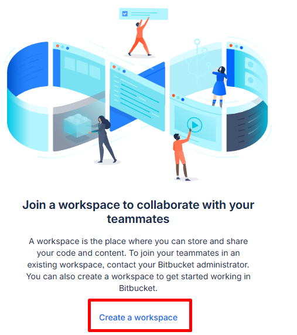
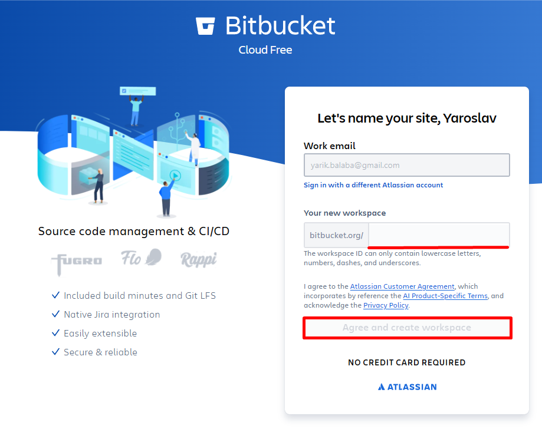
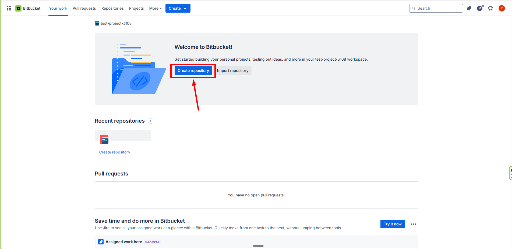
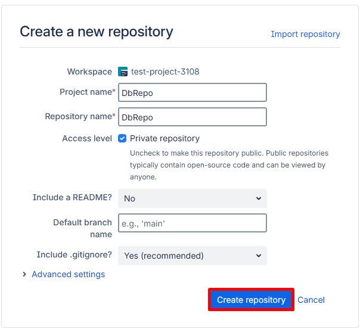

Покрокова інструкція на прикладі Bitbucket.

## 1. Створіть воркспейс

Воркспейс — простір, у якому зберігатиметься ваш код.

## 2. Назвіть воркспейс

Вкажіть ім'я і натисніть **Agree and create workspace**.

## 3. Створіть новий репозиторій

## 4. Заповніть назву проєкту та репозиторію

## 5. Оновіть .gitignore

Для проєктів Visual Studio беріть готовий шаблон:
[VisualStudio.gitignore](https://github.com/github/gitignore/blob/main/VisualStudio.gitignore).

Репозиторій готовий — далі
[завантажте його локально](/c/general/clone-repo-visual-studio).
