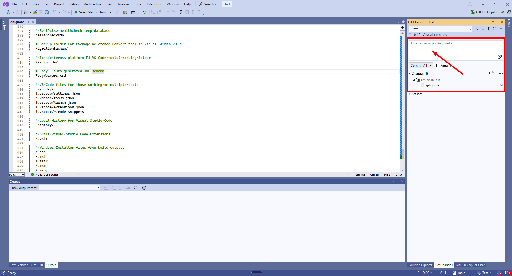
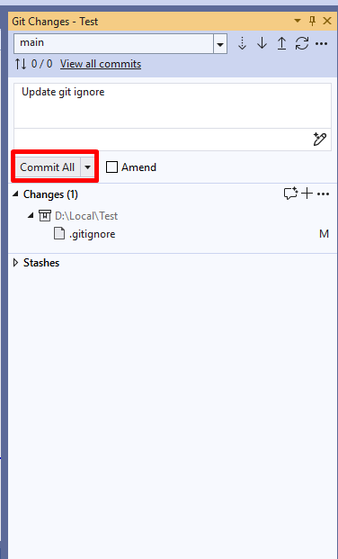
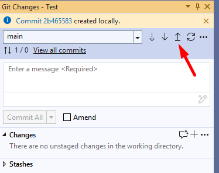

Покрокова інструкція на прикладі Visual Studio.

## 1. Змініть щось у репозиторії

Наприклад, оновіть вміст **.gitignore** з
[шаблону для Visual Studio](https://github.com/github/gitignore/blob/main/VisualStudio.gitignore).

## 2. Напишіть коментар до коміту

Коротко і по суті — що саме змінили (наприклад: `update git ignore`).

## 3. Натисніть Commit All

Коміт створюється **локально** — на сервері його ще ніхто не бачить.

## 4. Натисніть Push

Зміни відправляються у хмарний репозиторій. **Тільки після push**
вони видимі викладачу.

> У консолі ті самі кроки: `git add -A`,
> `git commit -m "update git ignore"`, `git push`.
