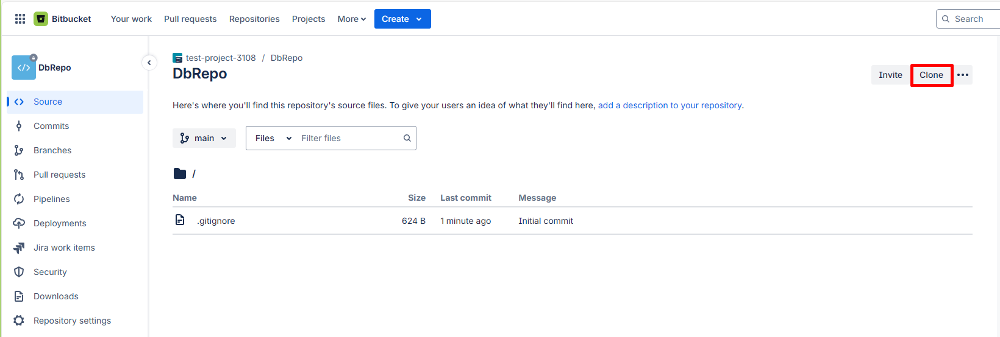
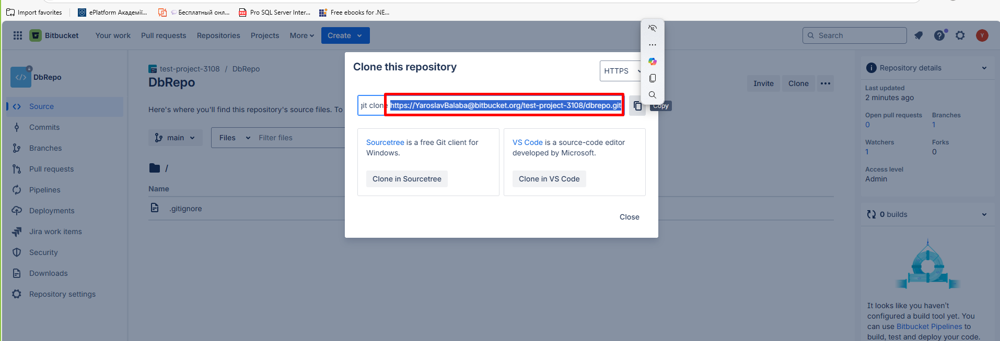
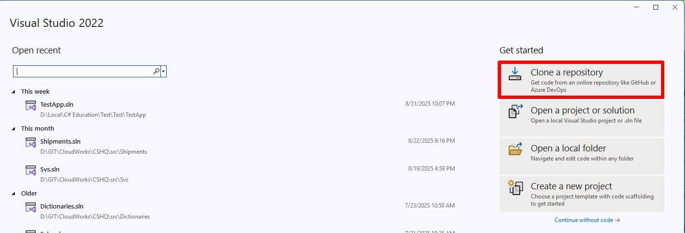
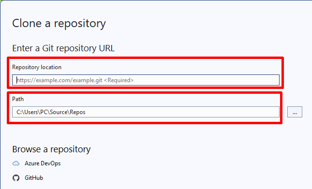

Покрокова інструкція на прикладі Visual Studio.

## 1. Відкрийте головну сторінку репозиторію

## 2. Скопіюйте URL-адресу

**Тільки URL** — без команди `git clone`.

## 3. У Visual Studio натисніть Clone a repository

## 4. Вставте URL і вкажіть локальну папку

URL — у поле **Repository location**, папку — у **Path**.

Репозиторій на вашому комп'ютері — час
[зробити перший коміт](/c/general/git/first-commit-visual-studio).

> Користуєтеся іншою IDE або консоллю? Ті самі кроки: скопіювати URL
> і виконати `git clone <url>` у потрібній папці.
