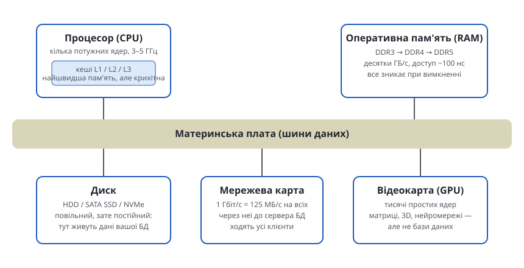
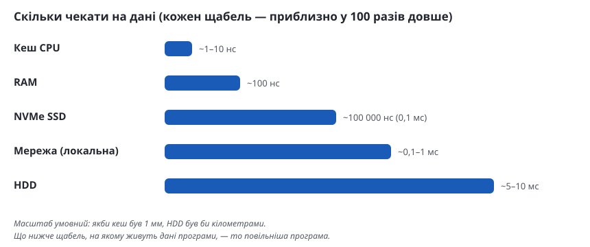

## Процесор: такти — це не операції

Частота 3–5 ГГц означає мільярди **тактів** за секунду. Але «середньої
кількості операцій за секунду» у процесора не існує — усе залежить від того,
що це за операції:

- завдяки конвеєру та суперскалярності ядро може виконувати **кілька**
  простих інструкцій за один такт;
- а промах кешу (даних немає у швидкій пам'яті, треба йти у RAM) коштує
  **сотні тактів** простою — процесор просто чекає.

Простий експеримент: тісний цикл на мільярд ітерацій компільованою мовою —
це **секунди** роботи одного ядра, інтерпретованою — вже **десятки секунд**,
а якщо кожна ітерація стрибає по пам'яті повз кеш — ще у рази довше.
Тож «мільярди операцій за секунду» — це про ідеальні умови, які у реальних
програмах трапляються рідко.

## Кеші CPU

Між ядром і RAM стоять кеші L1/L2/L3: крихітні (кілобайти–мегабайти),
але у десятки-сотні разів швидші за оперативну пам'ять. Код, який
«влазить у кеш» разом зі своїми даними, летить; код, який постійно ходить
у RAM, — повзе.

## Оперативна пам'ять (RAM)

Орієнтовні швидкості на канал:

| Покоління | Пропускна здатність | Затримка доступу |
|---|---|---|
| DDR3-1600 | ~13 ГБ/с | ~80–100 нс |
| DDR4-3200 | ~26 ГБ/с | ~80–100 нс |
| DDR5-6400 | ~51 ГБ/с | ~80–100 нс |

Цікаво, що затримка майже не змінюється поколіннями — росте саме
пропускна здатність. І все у RAM зникає при вимкненні живлення.

## Диск

Єдине енергонезалежне сховище у списку — і найповільніше:

| Тип | Лінійна швидкість | Випадковий доступ |
|---|---|---|
| HDD | ~100–200 МБ/с | ~100–200 IOPS, ~5–10 мс |
| SATA SSD | ~500 МБ/с | десятки тисяч IOPS |
| NVMe SSD | ~3–7 ГБ/с | сотні тисяч IOPS, ~0,1 мс |

## Мережа

- 100 Мбіт/с = **12,5 МБ/с**
- 1 Гбіт/с = **125 МБ/с**
- 10 Гбіт/с = **1,25 ГБ/с**

І це смуга **на всіх користувачів одразу**. Затримка у локальній мережі —
десяті частки мілісекунди, через інтернет — десятки мілісекунд.

## Загальна картина

## Відеокарта (GPU)

GPU — це тисячі маленьких простих ядер, які виконують примітивні операції,
зате всі одночасно. Ідеально, коли одну й ту саму дію треба зробити над
мільйонами елементів: перемноження матриць, 3D-графіка, нейромережі.
Погано, коли у коді багато розгалужень і випадкових звертань до пам'яті.
