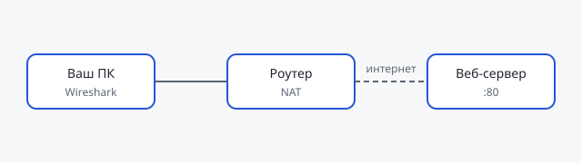

## Цель

Увидеть своими глазами, что браузер на самом деле отправляет в сеть,
и сопоставить пойманные пакеты с уровнями модели OSI.

## Топология стенда



## Ход работы

1. Установите [Wireshark](https://www.wireshark.org/download.html).
2. Запустите захват на активном интерфейсе.
3. Откройте в браузере любой сайт **по http** (например, `http://neverssl.com`).
4. Остановите захват и найдите свой запрос фильтром:

```
http.request.method == "GET"
```

5. Разверните пакет и найдите уровни: Ethernet → IP → TCP → HTTP.

## Контрольные вопросы

- Какой порт использовал ваш браузер, а какой — сервер?
- Сколько пакетов ушло на TCP-рукопожатие?
- Что изменится в захвате, если открыть сайт по https?
